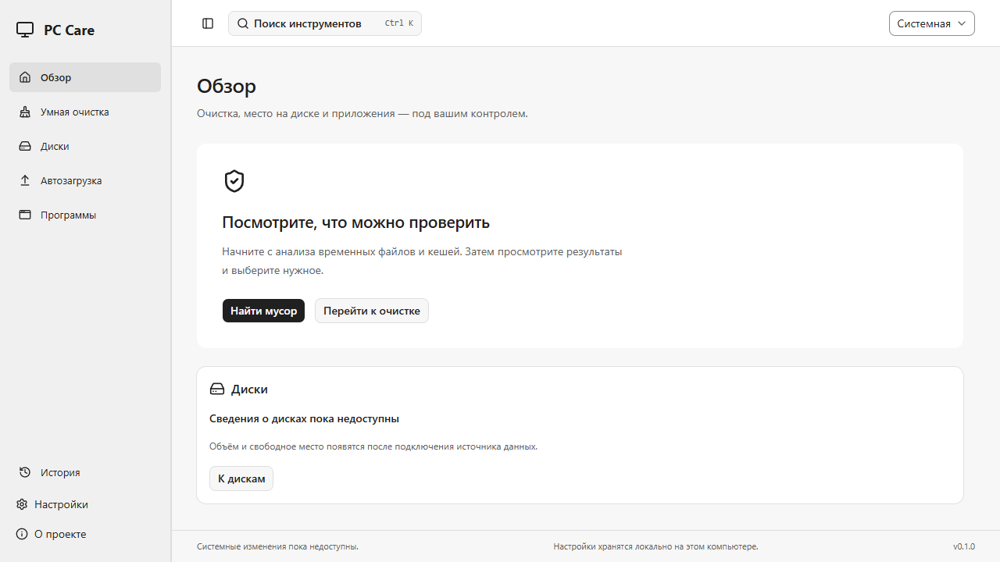
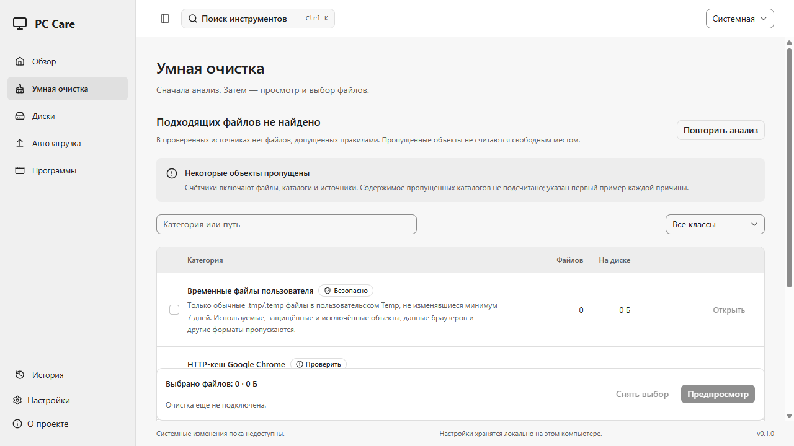
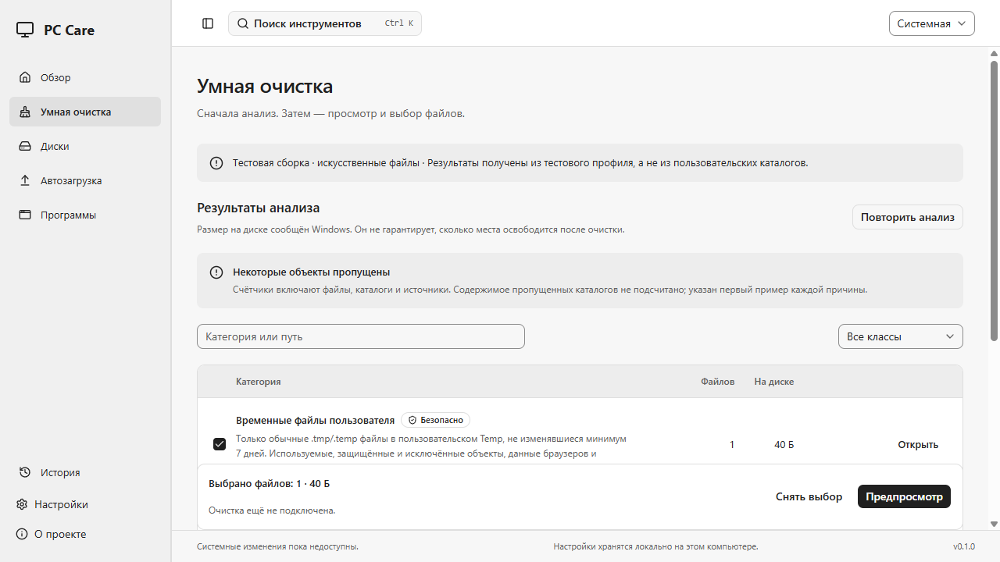
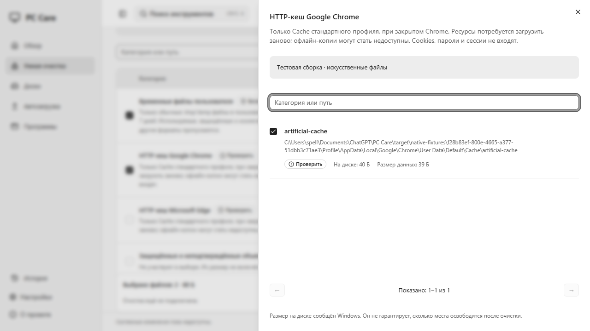
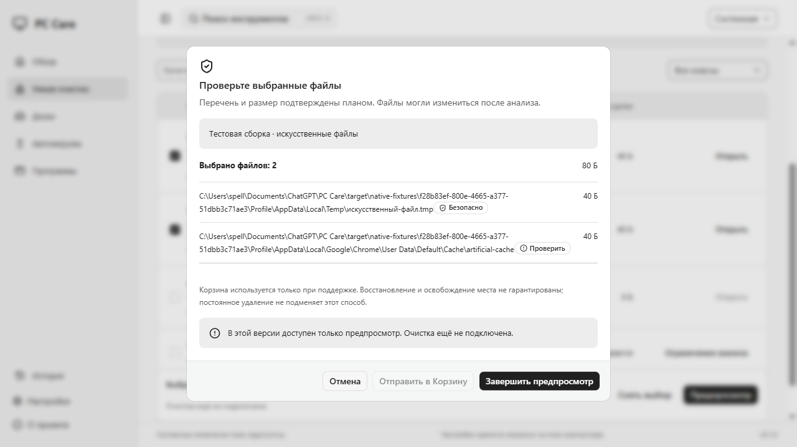

# PC Care: готовая сборка для просмотра

Это Windows x64 preview с настоящим анализом временных файлов и HTTP-кеша. Анализ не изменяет файлы. Очистка недоступна: кнопка «Отправить в Корзину» заблокирована, а завершение предпросмотра только закрывает проверенный выбор.

## Запуск без инструментов разработки

1. Откройте PR с SPE-64 и его проверку **Windows checks / windows**. В завершённом run скачайте artifact **pc-care-read-only-preview-<commit>** и распакуйте ZIP в отдельную папку.
2. Запустите `pc-care.exe` обычным пользователем Windows 10/11 x64. Нужен установленный Microsoft Edge WebView2 Runtime. Администратор, Rust, Node и pnpm для запуска не нужны.
3. На экране «Обзор» нажмите «Перейти к очистке» или сразу начните анализ. В «Умной очистке» дождитесь результатов; длительный анализ можно отменить и запустить заново.
4. Откройте категорию, проверьте файлы и нажмите «Предпросмотр». Категории «На проверку» выбираются вручную. «Завершить предпросмотр» не очищает диск.

Локальная копия для владельца находится в `target/read-only-preview/pc-care.exe`, контрольная сумма — рядом в `manifest.json`. Это unsigned preview, не публичный релиз. Если Windows блокирует запуск, не обходите защиту: используйте исходный код в доверенном окружении или дождитесь подписанной сборки. Если отсутствует WebView2, потребуется его обычная установка; этот EXE сам ничего не устанавливает.

При первом открытии настройки читаются локально. Изменение темы или исключений сохраняет только настройки PC Care после ответа backend. Сканирование ничего не сохраняет и не требует сети. Из «О проекте» можно отдельно открыть **явно помеченный прототип**; его примеры не являются системными результатами.

## Короткая демонстрация

| Экран / действие                 | Что проверить                                                                                                    |
| -------------------------------- | ---------------------------------------------------------------------------------------------------------------- |
| Обзор → Умная очистка            | Рабочая навигация, Ctrl+K, отсутствие выдуманного «здоровья ПК»                                                  |
| Сканировать                      | Настоящий Rust/Windows анализ, счётчик обработанных элементов без ложного процента                               |
| Результаты                       | Safe: `.tmp`/`.temp` UserTemp старше 7 дней; Review: поддерживаемый Default HTTP-кеш Chrome/Edge старше 24 часов |
| Открыть категорию → Предпросмотр | Точные выбранные ID, суммы allocation, защищённые файлы недоступны, удаление заблокировано                       |
| Отмена / повтор                  | Отмена ждёт ответа backend; быстрый scan может успеть завершиться раньше отмены                                  |
| Ошибка / пропуски                | Ошибка с повтором, частичные результаты и причины; отсутствие находок также нормальный результат                 |
| Настройки                        | Тема, язык интерфейса RU, исключения; подтверждённое локальное сохранение                                        |

На обычном ПК может не оказаться подходящих старых файлов. Не создавайте находки из реальных документов и не меняйте их даты ради демонстрации. Скриншоты подробностей и предпросмотра используют отдельную QA-сборку с **явно помеченными искусственными fixtures**. Это настоящий анализ через IPC, но такие данные не описывают ПК владельца. QA EXE не входит в artifact обычного preview.

## Происхождение и воспроизведение

Основа — PR #8, `codex/spe-62-cleanup-screen`, коммит `ec7c285469e3d1cdd180549aeb7d04b9f6289fde`, включает PR #1–7. Preview — ветка `codex/spe-64-read-only-demo`, без WIP executor из #9. Из #9 повторно использованы только готовность CDP по page target и regression test (`f01ac9f`): слушающий HTTP-порт ещё не означает, что WebView2 опубликовал страницу.

Для разработчика: checkout preview-ветки, `pnpm install --frozen-lockfile`, `pnpm build`, затем `target/release/pc-care.exe`. Для этой сборки используется обычный production profile без `qa-fixtures` и `vm-recycle-probe`. `pnpm build:installer` создаёт отдельный draft NSIS; его установка/удаление на хосте не проверяются.

## Карта существующих PR

Состояние проверено через GitHub 25.10.2026. **Все девять PR открыты, ни один не слит; main содержит только initialize commit.** Зелёный CI не заменяет приёмку владельца. Последние checks всех девяти прошли; ссылки ведут к конкретным runs.

| PR / задача                                                  | База                             | Результат и проверка                                                                                                                           | Риск / оставшаяся граница                                                                                                             |
| ------------------------------------------------------------ | -------------------------------- | ---------------------------------------------------------------------------------------------------------------------------------------------- | ------------------------------------------------------------------------------------------------------------------------------------- |
| [#1 SPE-55](https://github.com/SpellbourneDZ/pc-care/pull/1) | main                             | Инфраструктура, монохромный старт. [CI](https://github.com/SpellbourneDZ/pc-care/actions/runs/40007859544)                                     | In Review; фундамент, без системных действий                                                                                          |
| [#2 SPE-58](https://github.com/SpellbourneDZ/pc-care/pull/2) | codex/spe-55-monorepo            | Typed IPC, snapshots, mock-планы. [CI](https://github.com/SpellbourneDZ/pc-care/actions/runs/40055632738)                                      | In Review; mock не production scan, произвольных команд нет                                                                           |
| [#3 SPE-59](https://github.com/SpellbourneDZ/pc-care/pull/3) | codex/spe-58-typed-operation-api | Allowlist, exclusions, identity/revalidation. [CI](https://github.com/SpellbourneDZ/pc-care/actions/runs/40058683390)                          | In Review; policy read probe не разрешает мутацию                                                                                     |
| [#4 SPE-56](https://github.com/SpellbourneDZ/pc-care/pull/4) | codex/spe-59-safety-policy       | shadcn UI, tokens, четыре помеченных прототипа. [CI](https://github.com/SpellbourneDZ/pc-care/actions/runs/40075483189)                        | In Review; прототип не изображает реальные результаты                                                                                 |
| [#5 SPE-57](https://github.com/SpellbourneDZ/pc-care/pull/5) | codex/spe-56-desktop-ux          | Навигация, Ctrl+K, typed settings. [CI](https://github.com/SpellbourneDZ/pc-care/actions/runs/40078919112)                                     | In Review; пишет только настройки/исключения PC Care                                                                                  |
| [#6 SPE-60](https://github.com/SpellbourneDZ/pc-care/pull/6) | codex/spe-57-app-shell           | Windows CI, unsigned draft NSIS, PE/hash smoke. [CI](https://github.com/SpellbourneDZ/pc-care/actions/runs/40079304905)                        | In Review; install/uninstall и полная Windows/DPI матрица не подтверждены                                                             |
| [#7 SPE-61](https://github.com/SpellbourneDZ/pc-care/pull/7) | codex/spe-60-windows-ci          | Реальный read-only scan Temp/HTTP-кешей, группировка причин. [CI](https://github.com/SpellbourneDZ/pc-care/actions/runs/40084856326)           | In Review; только фиксированные roots/rules, ограниченный объём анализа                                                               |
| [#8 SPE-62](https://github.com/SpellbourneDZ/pc-care/pull/8) | codex/spe-61-cleanup-analysis    | Рабочие результаты, ручной Review, точный предпросмотр. [CI](https://github.com/SpellbourneDZ/pc-care/actions/runs/40095559373)                | In Review; завершение предпросмотра без execute, подходит для demo                                                                    |
| [#9 SPE-63](https://github.com/SpellbourneDZ/pc-care/pull/9) | codex/spe-62-cleanup-screen      | Журнал, reservations, private recovery mapping, 72 Rust tests host/VM. [CI](https://github.com/SpellbourneDZ/pc-care/actions/runs/40151980120) | **Draft / In Progress**; executor не IPC, staging/revalidation/TOCTOU/recovery UI и полная VM-матрица не готовы; в preview не включён |

Сначала владельцу достаточно проверить EXE из preview; объединять стек для запуска не требуется. После явного принятия исходные PR проверяются по порядку #1 → #2 → #3 → #4 → #5 → #6 → #7 → #8. При сохранении ancestry последовательный merge позволяет перенаправлять следующий PR на main без потери общей базы. Если выбран squash/rebase, сначала согласовать перенос зависимых коммитов и повторить CI; сейчас историю не переписываем. Preview проверяется как отдельный потомок #8. #9 остаётся отдельной веткой до доказательства safety gate; перенос его будущих изменений согласуется после demo. Автоматического merge нет.

## Ограничения

- Production cleanup/delete не реализованы; данные не перемещаются в Корзину. Нулевые изменения файлов не означают успешную очистку.
- Диски, автозагрузка и программы пока показывают честные состояния «не готово»; история выполнения очистки пуста. Следующая задача — SPE-65.
- Байты — Windows allocation выбранных файлов, не обещание освобождённого места. Locked/protected/unsupported элементы пропускаются с причиной; truncated явно отмечен.
- Полная Windows 10/11, обычный пользователь и DPI 125/150% матрица, install/uninstall, подпись и публичный релиз остаются отдельными gates. Ранее использованная VM имеет истёкший Evaluation; её старые тесты не подменяют эту матрицу.

## Проверка этого preview

Локально 25.10.2026 прошли: typecheck, lint, Prettier, 26 frontend tests, 30 browser tests (light/dark/720×520/scale 125/150%), cargo fmt/clippy и 48 Rust tests, production build с web build, 2 native tests (готовность CDP и release EXE/WebView2 с настоящим scan), отдельный QA build и 2 native IPC tests настроек/анализа на fixtures. Production EXE запущен offline, без сохранения пользовательских настроек. В native smoke не было подходящих старых файлов; пустой результат с причинами пропусков ожидаем.

Отмена и отсутствие snapshot после неё проверены Rust tests; UI отмены, empty/error/partial и успешный повтор после ошибки — browser/компонентными тестами с явно искусственным IPC. Это не утверждение о полном ручном native cancel/error сценарии или всей Windows/DPI матрице. Native QA проверил настоящий scanner, ручной Review, точный список предпросмотра, заблокированное удаление и неизменность содержимого fixtures.

Локальный production EXE: **9 190 400 байт**, SHA256 **8acf718e7a572a9da86e66c1d6286ad277bb19f4c906486254dcbbc0719988ef**; PE x64 проверен существующим `verifyPe`. Hash относится к локальной сборке; CI соберёт свой artifact с manifest в соседнем draft NSIS artifact. Установщик в этой задаче на хосте не запускался. Vite предупреждает о JS chunk 545,72 kB; это не ошибка сборки, разделение прототипа можно рассмотреть при дальнейшей работе с модулями.

UI проверен по ui-design / ui-art-direction без редизайна; sasha — для инструкции запуска, ponytail-review — для diff и callers. Из deslop прочитаны AGENTS.md и primitives; shadcn и монохромные tokens проекта сохранены. Новые анимации и зависимости не добавлялись. В просмотренном diff блокирующих замечаний не найдено.

### Пять экранов Windows WebView2

Первые два — обычный production EXE. Последние три — отдельный QA EXE, искусственные файлы отмечены на экране. Изображения не выдают тестовые находки за содержимое ПК владельца.

Ссылка на свежий CI и download artifact — в PR SPE-64. Исходный PR #8 также имеет [прошедший CI с draft NSIS artifact](https://github.com/SpellbourneDZ/pc-care/actions/runs/40095559373); старые artifacts сохраняются только 7 дней и не содержат новых изменений SPE-64.
