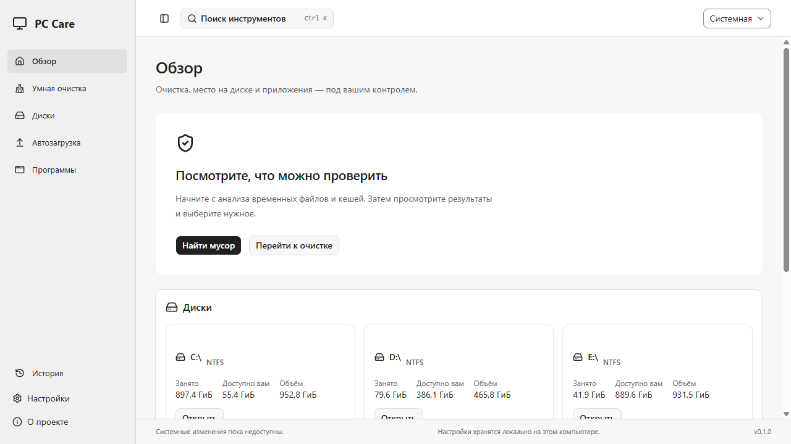
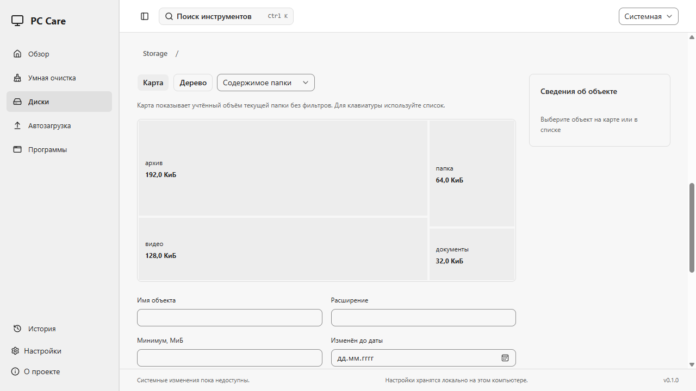
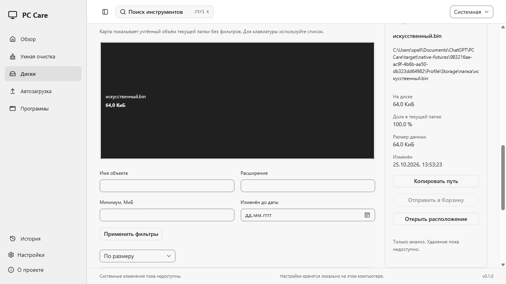
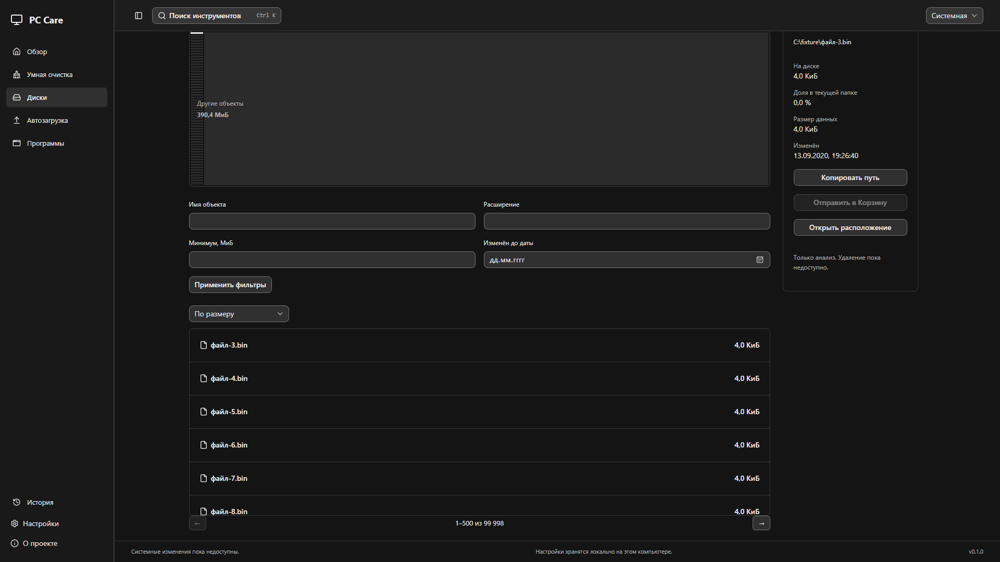
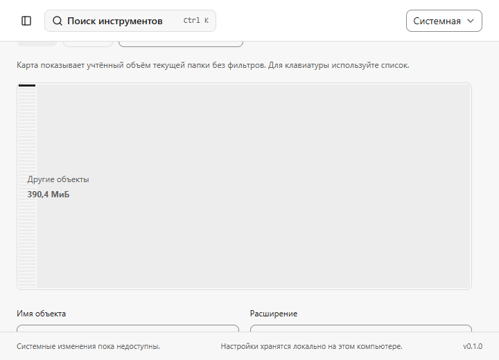

# SPE-65: read-only анализ дисков

## Что работает

«Обзор» показывает реальные сведения о локальных дисках. В «Дисках» можно выбрать том или ввести полный путь к папке, запустить анализ, отменить его и повторить. Карта размеров, навигация по папкам, breadcrumbs и список крупных файлов используют один immutable отчёт. Инспектор показывает путь, allocation, размер данных, долю учтённого объёма и дату изменения. Удаление заблокировано.

Поиск по имени, расширение, минимальный объём на диске, дата изменения и сортировка применяются на backend. Они меняют список, но сохраняют итоги папки и карту без фильтров. Крупные файлы ищутся внутри текущей папки со всеми её потомками. Дата «до» означает начало выбранного дня в локальном часовом поясе. Список выдаётся страницами по 500; в DOM остаётся около 12 строк. Стрелки вверх/вниз и Home/End перемещают фокус по странице, кнопки страниц открывают остальные записи. Карта имеет клавиатурную альтернативу в списке.

Карта отображает до 60 крупнейших дочерних объектов. Остальной учтённый объём объединён в «Другие объекты»; это агрегат, не файл и не объект удаления. Нулевой allocation не рисуется площадью, но доступен в списке. Суммы считаются целыми u64/BigInt, без потери байтов в JavaScript number. Динамическая геометрия карты/виртуального списка использует nonce stylesheet, без ослабления CSP.

## Источники и ограничения обхода

- Только локальные fixed NTFS-тома. Removable, network и неподдержанные файловые системы имеют отдельное состояние; приложение не запрашивает UAC и не включает их автоматически. Папка выбирается полным DOS-путём, без shell и произвольной команды.
- Итеративный depth-first обход. Каталоги пути удерживаются с FILE_LIST_DIRECTORY и без delete sharing; reparse/junction/mount/cloud-объекты не раскрываются. Case-sensitive директории, неожиданный canonical path, другой volume, повторная identity и ошибки metadata приводят к пропуску. Это живой read-only обход, а не атомарный снимок всего тома.
- Исключения с родительским наследованием берутся из подтверждённых настроек при старте. Сканирование читает только метаданные и имена, не содержимое файлов. Это отдельный read-only scope, он не расширяет cleanup allowlist и не выдаёт разрешение на мутацию.
- Hardlinks с количеством ссылок больше одной не включаются в суммы и показываются как пропуск. Повторные identity также не считаются. Поэтому частичный отчёт не выдаётся за полный размер диска.
- Обычные allocation bytes — FILE_STANDARD_INFO; compressed/sparse — FILE_COMPRESSION_INFO по handle. Это не гарантированно освобождаемые байты. Служебные структуры файловой системы и альтернативные потоки отдельно не анализируются.
- Лимиты: 100 000 узлов, 1 000 000 посещённых записей, 32 MiB учитываемых данных snapshot, общий timeout до 300 s, группированные причины. Это бюджет данных, не обещание фиксированного RSS. При достижении лимита доступный префикс публикуется как **truncated**; для продолжения выбирается меньшая папка.
- Один настоящий filesystem worker на общий Engine: cleanup и storage не запускаются одновременно. После отмены слот занят до завершения worker. Отмена не публикует отчёт. Удерживается только последний storage snapshot; новый анализ делает прежние scan/node IDs недоступными.

Данные free/available/total получаются из GetDiskFreeSpaceExW. UI использует объём и доступное место **для текущей учётной записи**, поэтому учитывает квоты и не вычитает общую свободную ёмкость из пользовательской квоты. Последние дата и область завершённого анализа каждого диска хранятся в памяти до выхода, без записи частных путей в историю/логи. Кнопка обновления перечитывает данные; завершение скана обновляет Dashboard.

## Действия и права

`list_volumes`, `start_storage_scan`, `get_storage_page` и `open_storage_location` добавлены в существующий закрытый operation_api. Общие task IDs, progress, cancel и проверки timeout переиспользованы. Старый `start_scan(kind=storage)` отклоняется: target обязателен в отдельном typed request. Rust остаётся источником TS bindings.

Node ID — номер внутри конкретного scan UUID, не CandidateId и не разрешение на удаление. Storage не публикует cleanup candidates и не создаёт исполняемый plan. Private file identity исключена из JSON/TS. «Отправить в Корзину» не имеет обработчика и недоступна для всех storage объектов до SPE-63 gate.

«Копировать путь» требует явного нажатия и сообщает об отказе clipboard API. «Открыть расположение» принимает только scan/node IDs, заново проверяет настройки, canonical path, identity и metadata, затем использует PIDL + SHOpenFolderAndSelectItems. Не запускает файл, PowerShell, cmd, строку из UI или UAC. Обнаруженная замена объекта отклоняется; эта read-only проверка не является разрешением на удаление и не доказывает устранение финального check/use race для мутаций.

Системные эффекты очистки не включались. Тесты Explorer проверяют подготовку и отказ на заменённом искусственном объекте, **не запускают Explorer автоматически на хосте**. Положительный Explorer/clipboard flow в отдельной VM, полная Windows 10/11 / обычный пользователь / native DPI матрица и install/uninstall ещё не подтверждены. Длительные VM-эксперименты SPE-63 не возобновлялись.

## Проверка и запуск

Локальная среда: Windows 11 Pro x64, 10.0.26200. Прошли typecheck/lint/format, 27 frontend tests, 40 browser tests, cargo fmt/clippy и 55 Rust tests; после добавления отдельного storage-cap regression прошли 10 целевых Rust tests (включая cancellation/rescan, cap, metadata/identity, compressed allocation и 100k records). Финальные изменения процентов/инспектора дополнительно прошли 10 browser tests во всех пяти проектах. Production build включает web build; 2 production native tests и 3 native QA tests прошли в WebView2 offline без CSP errors.

QA проверяет реальный scanner на своих UUID fixtures: карту четырёх папок, переход в папку, инспектор, фильтр и неизменность файла. Fixtures помечены в интерфейсе. 100k records проверены как синтетическая модель и mock IPC; это не утверждение о сканировании 100k реальных файлов в VM.

Обычная сборка: `pnpm build` → `target/release/pc-care.exe`. Упакованная локальная копия для владельца — `target/storage-preview/pc-care.exe`, рядом manifest, инструкция и screenshots. QA EXE не входит в обычную сборку. CI готовит отдельный read-only EXE artifact и draft NSIS/manifest; публикация релиза и merge PR не выполняются.

### Скриншоты

Обычный Dashboard использует реальные сведения о дисках. Два native storage экрана ниже показывают только искусственные QA-файлы; dark/compact — явно помеченные browser IPC fixtures.

## Review

Ponytail-review: проверены callers operation_api, Engine lifecycle/retention, storage query/aggregate, Windows guards, UI/controller, shared helpers и bindings. Небезопасных команд или расширения delete permissions нет. UI Design / better-layout сохранены для существующих монохромных tokens; sasha — для RU-текстов. Новых runtime зависимостей и декоративных анимаций нет; у windows-sys включена только дополнительная feature Shell_Common для PIDL API.

Следующая укрупнённая задача — SPE-70. SPE-63 остаётся отдельно в Draft #9; read-only storage не закрывает её safety gate. SPE-65 переводится в In Review после свежего hosted CI; Done остаётся за владельцем.

Источники Windows API: [SHOpenFolderAndSelectItems](https://learn.microsoft.com/en-us/windows/win32/api/shlobj_core/nf-shlobj_core-shopenfolderandselectitems), [FileCompressionInformation](https://learn.microsoft.com/en-gb/windows-hardware/drivers/ddi/ntifs/ns-ntifs-_file_compression_information), [GetDiskFreeSpaceExW](https://learn.microsoft.com/en-us/windows/win32/api/fileapi/nf-fileapi-getdiskfreespaceexw).
