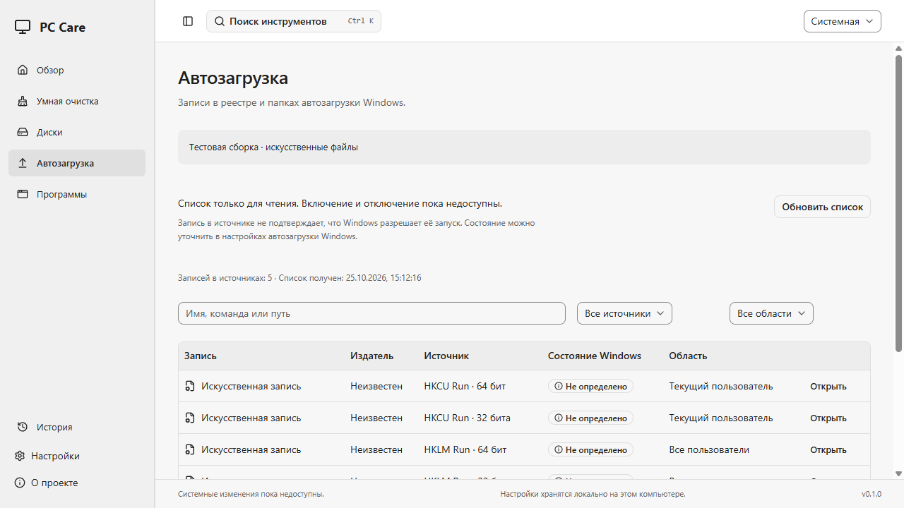
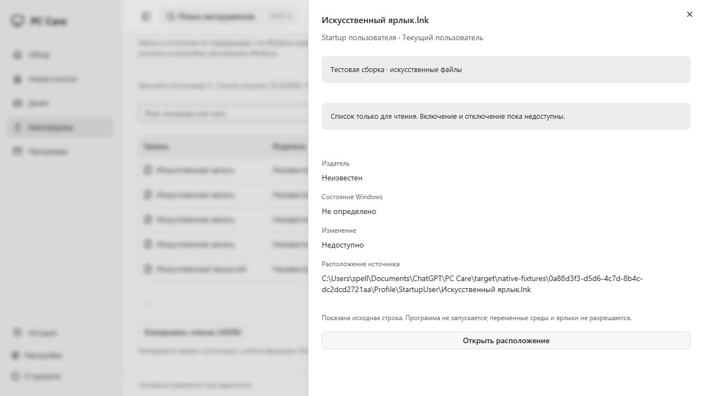
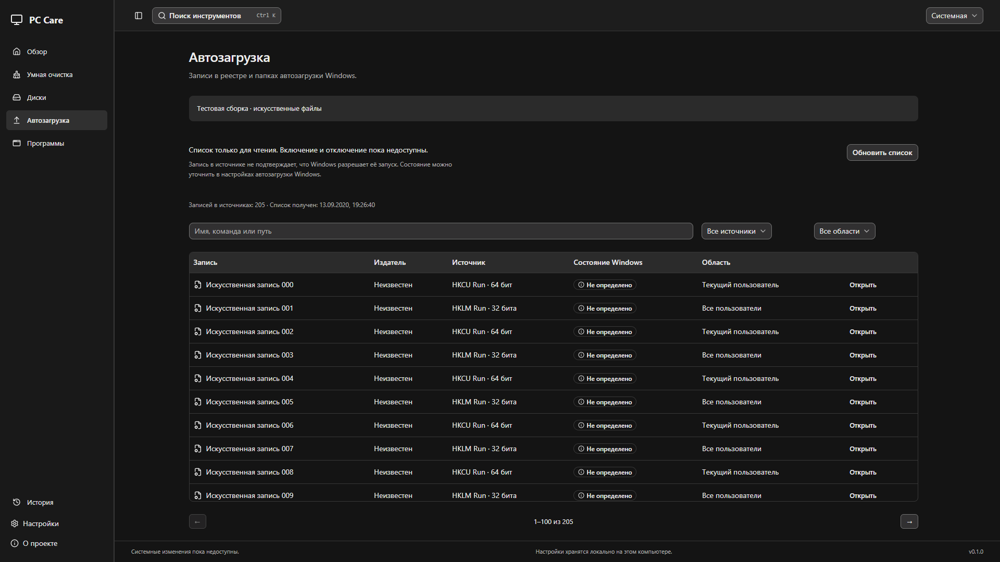
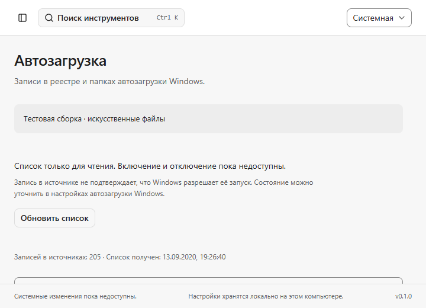

# SPE-70: список автозагрузки

## Доступное поведение

«Автозагрузка» читает записи HKCU и HKLM `Software\Microsoft\Windows\CurrentVersion\Run` в 32- и 64-битных представлениях, а также пользовательскую и общую папки Startup. Таблица показывает имя, источник, область действия, издателя и состояние Windows. Поиск по имени, исходной команде и пути, фильтры источника/области и страницы по 100 записей работают на backend. Список обновляется вручную; изменение настроек отмечает старый снимок до обновления.

Каждая строка — запись конкретного источника. Представления реестра могут разделять данные: одинаковые строки не означают несколько разных программ. Счётчик показывает записи, а не число уникальных приложений.

Наличие регистрации не подтверждает разрешённый запуск Windows. `enabled=null` отображается как «Не определено»; недокументированные значения StartupApproved не трактуются как достоверный статус. Издатель остаётся «Неизвестен»: бинарные файлы и цели ярлыков не загружаются ради имени или иконки. Область «Все пользователи» описывает источник, а не наличие прав на запись. Изменение недоступно для всех записей, переключателей нет.

Инспектор показывает исходную строку команды с сохранением кавычек, аргументов, Unicode и переменных среды. Программа не запускается; команда не разбирается как shell, переменные и `.lnk` не разрешаются. Для Run расположение исполняемого файла не угадывается, кнопка открытия недоступна. Для файла Startup доступно открытие расположения через существующий PIDL adapter: backend принимает только snapshot/entry IDs и повторно проверяет исключения, путь, identity и metadata. Файл не запускается.

«Копировать список (JSON)» требует явного нажатия и учитывает фильтры. Экспорт содержит имя, источник, область, издателя и nullable-состояние, время, признак fixtures, неполноту и группированные причины пропуска. Поля команды, пути и приватная identity исключены. **Имя записи само может содержать личные данные**, поэтому экспорт не является обезличиванием. Буфер обмена не изменяется автоматически; отказ показывается рядом с действием.

## Границы backend

- Три запроса в закрытом `operation_api`: `refresh_startup`, `get_startup_page`, `open_startup_location`. Произвольных ключей/команд/путей и команд изменения автозагрузки в IPC нет. Rust генерирует TS bindings.
- Реестр открывается только с `KEY_QUERY_VALUE` и выбранным WOW64 view. Компоненты фиксированного пути открываются с `REG_OPTION_OPEN_LINK`; обнаруженный REG_LINK отклоняется. `RegCreateKey`, `RegSetValue`, `RegDeleteValue` не вызываются. REG_SZ/REG_EXPAND_SZ читаются как ограниченный UTF-16; повреждённые данные и неподдерживаемые типы дают отдельные причины.
- Known Folders получаются без создания каталогов. Папки читаются по метаданным с удержанием каталогов пути; reparse/junction/cloud/hardlink, исключённые пути и ошибки доступа пропускаются. `desktop.ini` не считается программой. Содержимое файлов, цели ярлыков, иконки и исполняемые модули не читаются.
- Один сохранённый Startup snapshot, до 2048 записей и 1 MiB учитываемых данных; это бюджет данных, не предел RSS. На источник — до 4096 посещённых значений/элементов, данные значения — до 64 KiB. Достижение лимита публикует неполный список с причиной. Backend выдаёт до 500 записей за запрос; UI — 100. Новый snapshot делает старые IDs недоступными.
- ACL/недоступность/повреждённые данные/лимиты показываются группированно, без частных команд в диагностике. Снимок не атомарен относительно внешних изменений Windows; дата и ручное обновление обозначены явно.
- `qa-fixtures` заменяет Run четырьмя скомпилированными искусственными значениями, папки — только внутри проверенного UUID fixture root. QA не создаёт ключи реестра хоста и не включается в обычную сборку. На экране есть явная маркировка.

## Проверка

Локальная среда — Windows 11 Pro x64 / WebView2. Прошли typecheck, lint, format, TS bindings check, 30 frontend tests, 50 browser tests, cargo fmt/clippy и 62 Rust tests. Production Windows build и 2 production native tests прошли; 4 native QA tests проверили настройки, cleanup/storage и новый Startup flow. После последнего уточнения текстов и settings-revision поведения production build и все 6 native проверок повторно прошли.

Новые проверки охватывают UTF-16/кавычки/аргументы, неподдерживаемые типы, лимиты, страницы/фильтры, истечение IDs, отсутствие mutation IPC, закрытые реальные Registry views только для чтения, искусственную папку Startup и неизменность её файлов. UI проверяет unknown state без Switch, инспектор/возврат фокуса, ошибку расположения внутри Sheet, ограниченный JSON export и отказ clipboard. Native QA использует файл с расширением `.lnk`, содержащий обычный тестовый текст: он не разрешается и его байты не меняются. Native production читает реальные источники, не записывает команды в evidence и не меняет настройки пользователя.

Browser fixtures проверены в light/dark, 720×520 и масштабах 125/150%; это не заменяет полную native DPI/Windows 10/11/обычный пользователь матрицу. Положительное открытие Explorer и запись в настоящий clipboard не выполнялись автоматически на хосте. Registry-link сценарии не создавались на хосте ради теста. Системных изменений и VM-сценариев записи в этой задаче пока нет.

## Что ещё не выполнено

SPE-70 прямо допускает read-only UI без доказанной обратимой записи. Этот вариант реализован. Enable/disable, сохранение исходных значений, durable backup/rollback, проверка прав на запись/UAC, reboot/logon и disposable VM evidence **не реализованы и не заявляются выполненными AC**. `can_toggle=false` для каждого источника. Scheduled Tasks — опциональная часть Linear, отложена до основных безопасных изменений. Gate настоящей очистки SPE-63 также остаётся отдельным Draft PR #9.

PR этого блока создаётся поверх SPE-65 / PR #11 без merge. До hosted CI и оценки ограничений — Draft / In Progress, без Done. Следующий независимый модуль по Handoff — SPE-74, список установленных приложений. Runtime-зависимости и анимации не добавлены; включена только Registry feature существующего windows-sys.

## Демонстрация

Обычный EXE: `pnpm build` → `target/release/pc-care.exe`. Отдельная копия для владельца — `target/startup-preview/pc-care.exe` с manifest/инструкцией. QA executable туда не включается. Скриншоты ниже содержат только явно помеченные искусственные данные.

