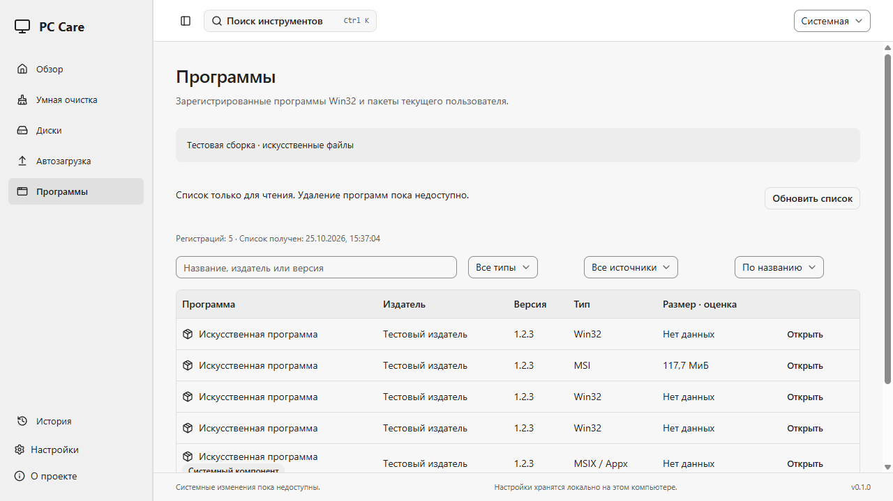
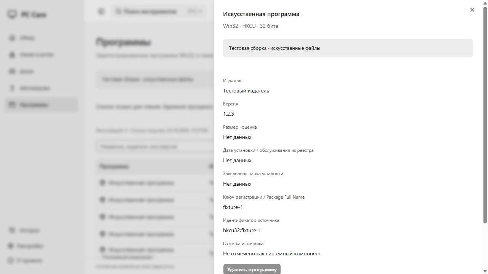
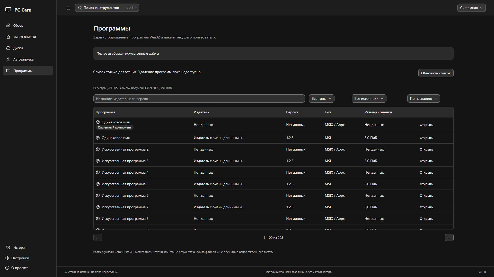
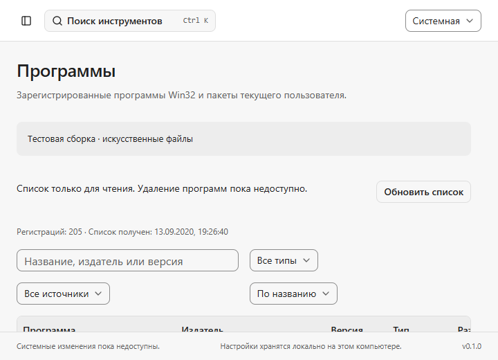
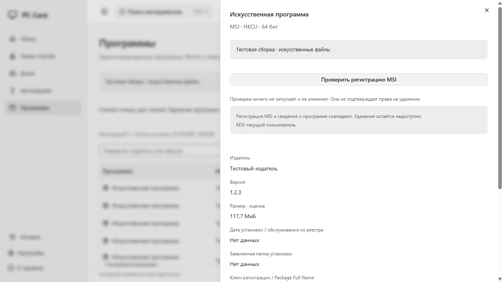
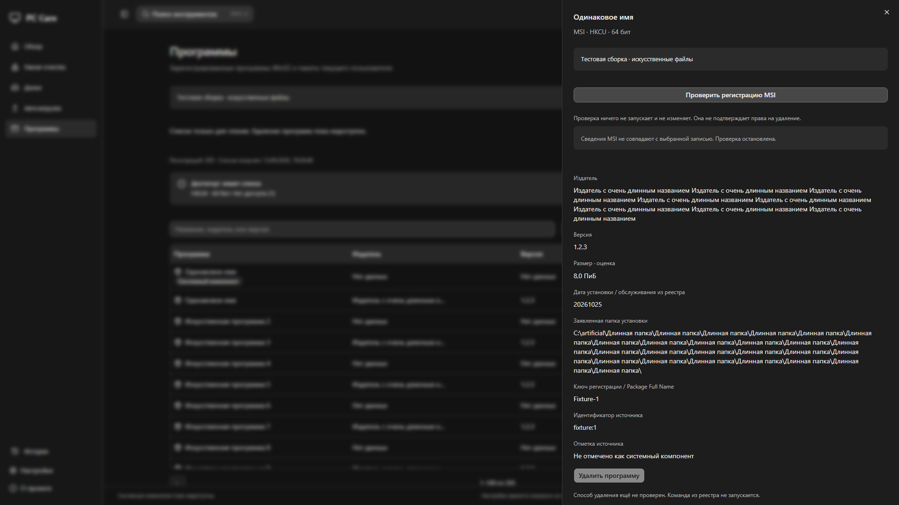
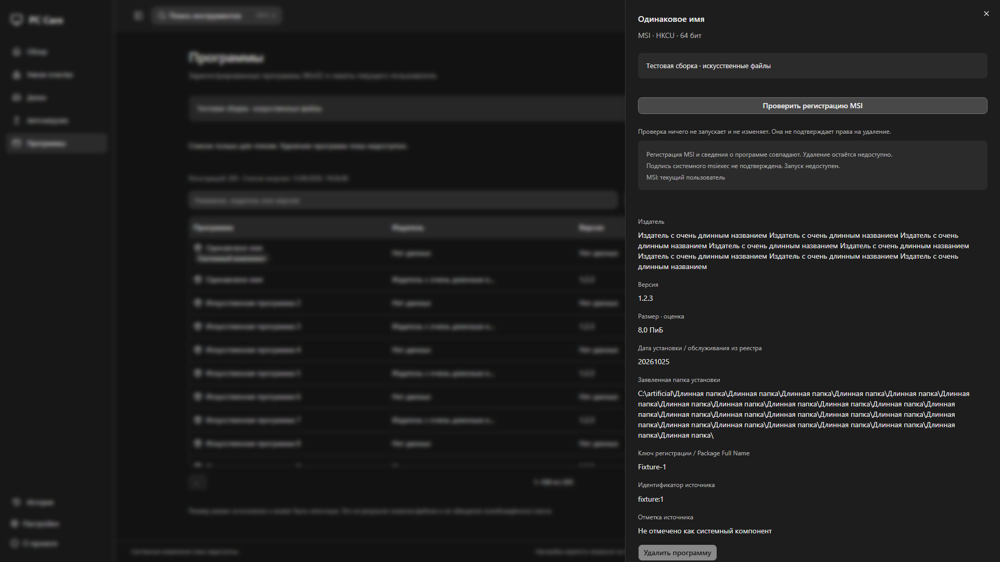
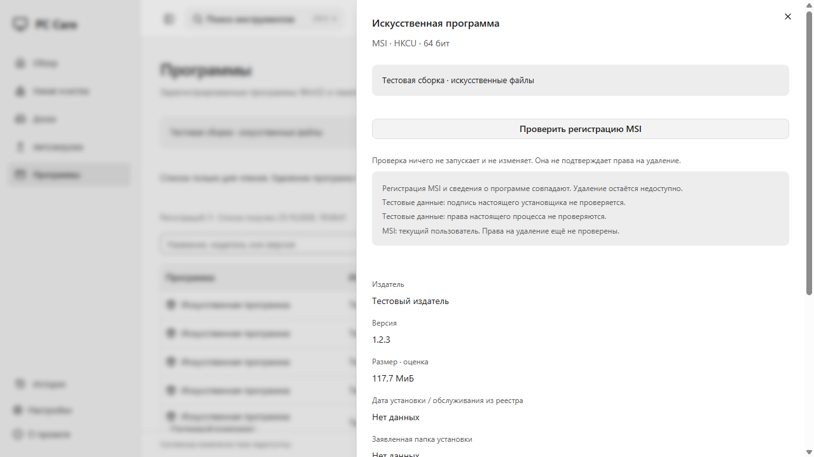

# SPE-74: список установленных программ

## Текущий этап

В «Программах» работает список регистраций Win32/MSI из HKCU/HKLM Uninstall (32/64-bit views) и пакетов MSIX/Appx **текущего пользователя** через официальный PackageManager. Это первый этап укрупнённой SPE-74, а не завершённый деинсталлятор. Задача остаётся In Progress, PR — Draft.

Таблица показывает имя, издателя, версию, тип и оценку размера, когда источник их предоставил. Поиск по имени/издателю/версии, фильтры типа и источника, сортировка и страницы по 100 работают на backend. Карточка показывает источник, точную регистрацию/Package Full Name, заявленную папку, дату установки/обслуживания, известную системную отметку и причину недоступности удаления. Клавиатура открывает карточку и возвращает фокус после закрытия. Данные обновляются вручную.

ID зависит от источника и точного ключа регистрации либо Package Full Name. Одинаковые DisplayName не объединяются. 32/64 views могут разделять данные, один продукт также может иметь несколько регистраций; счётчик — число **регистраций**, не обещание числа уникальных приложений. Registry-значения — заявления установщика, а не подтверждённая цифровая подпись издателя.

EstimatedSize переводится из KiB в целые bytes и помечается как **оценка источника**, без анализа содержимого файлов. Нулевое/отсутствующее значение показывается как «Нет данных». MSIX размер не вычисляется обходом WindowsApps. InstallDate из Registry показывается исходной строкой: Windows Installer может обновлять его при обслуживании продукта. Не следует трактовать его как гарантированную дату первого запуска/установки. Суммы u64 передаются десятичными строками, UI использует BigInt formatter.

Иконка — локальный монохромный символ Package. DisplayIcon, бинарные PE и удалённые ресурсы не загружаются ради логотипов. Пакеты framework/resource/system отмечаются по официальным свойствам; неопределённая отметка остаётся неизвестной. NoRemove блокирует действие отдельно от SystemComponent и не превращает обычную программу в «системную».

## Безопасность и ограничения чтения

- В существующий закрытый operation_api добавлены `refresh_apps`, `get_apps_page` и read-only `check_uninstall`. Frontend не задаёт Registry path, shell command или uninstall argv. Строка UninstallString читается только для определения наличия метода, не сохраняется в snapshot/TS/UI/логи и не исполняется. Наличие строки не означает безопасный деинсталлятор.
- Registry helper общий со Startup: только QUERY_VALUE, при перечислении — ENUMERATE_SUB_KEYS, фиксированные источники, REG_OPTION_OPEN_LINK и отказ при REG_LINK в любом открываемом компоненте. Создания/изменения/удаления ключей нет. Реестровые ссылки не создавались на хосте ради тестов.
- REG_SZ/REG_EXPAND_SZ читаются как ограниченный UTF-16 без раскрытия переменных, DWORD — строго по типу/размеру. Повреждённая запись пропускается с группированной причиной, ошибка доступа не маскируется под полный список. Ключи без DisplayName не выдаются за приложения.
- PackageManager получает пустой SID только для текущего пользователя; запросов других пользователей, UAC и RemovePackage нет. MTA apartment закрывается на том же потоке после чтения. Windows API может отказать: источник тогда явно неполный, а не «нулевые установленные приложения».
- До 4096 записей и 16 MiB учитываемых данных snapshot, один retained snapshot. Registry source — до 8192 дочерних ключей, value — до 64 KiB; MSIX — до 4096 пакетов. Превышение даёт truncated и причину. Это бюджет данных, не лимит RSS. Список выдаётся до 500 записей за запрос; UI — 100. Новый refresh делает старый snapshot ID недоступным.
- Список читается в blocking worker вне UI thread. Снимок не атомарен относительно внешних установок/удалений. Долгий task progress/cancel для последующих uninstall/leftovers flows ещё не реализован.
- QA использует только скомпилированные искусственные регистрации, после проверки своего UUID fixture root. Никаких Registry fixtures хоста не создаётся. QA feature отсутствует в обычном EXE, искусственные сведения явно помечены.

Прямой `windows = 0.62.2` уже присутствовал транзитивно в lockfile; он закреплён напрямую с нужными WinRT features для PackageManager. Это официальный binding, который исключает PowerShell/WMI и собственные COM vtables. Существующий windows-sys остаётся для Registry. Новых JS runtime dependencies, анимаций и отдельной UI-библиотеки нет.

## Проверка регистрации MSI без запуска

В карточке несистемной MSI-записи можно нажать «Проверить регистрацию MSI». Backend получает только snapshot/app IDs, находит собственную запись, проверяет строгий nonnil ProductCode GUID и заново читает её из фиксированного источника. Никакие свойства/аргументы MSI не принимаются из UI.

`MsiGetProductInfoExW` читает состояние и сведения о продукте с NULL SID: только контекст машины или текущего пользователя. Проверяются machine, user managed и user unmanaged. Допустима ровно одна регистрация с State=5 и контекстом, соответствующим HKCU/HKLM; несколько контекстов, только advertised, отсутствие установки, неизвестность или отказ доступа не дают положительного результата. InstalledProductName, Publisher и VersionString должны точно совпасть со снимком, а регистрация повторно сверяется после MSI-запросов. Изменённый/заменённый snapshot ID отклоняется. Это read-only сверка живых данных, не доказательство устранения race для будущей мутации.

Положительный результат — **msi_matched**, не разрешение удалить. Backend возвращает предложение аргументов `/x`, canonical ProductCode, `/norestart`; оно не исполняется, не включает тихое удаление, принудительную перезагрузку или произвольные MSI properties и не является OperationPlan. `execution_enabled=false` при любом результате; команды запуска в IPC нет. Совпадение регистраций не является цифровой подписью издателя или гарантией безопасности custom actions MSI. Read-only проверка системного binary описана ниже; полномочия, точное подтверждение и поведение uninstall ещё не доказаны.

UI показывает состояние и контекст установки, сохраняет выключенной кнопку удаления, отклоняет результат с чужими snapshot/app IDs, сбрасывает старый результат при смене записи/фильтров/обновлении. Ошибка видна внутри карточки. QA использует вымышленный GUID и скомпилированные MSI properties только после проверки fixture root; ни одного реального MSI query/процесса в QA нет.

## Системный установщик: read-only проверка файла и подписи

После совпадения MSI backend отдельно проверяет фиксированный `msiexec.exe` из `GetSystemDirectoryW`. PATH, переменные среды и UninstallString не участвуют. Каждый каталог пути удерживается с FILE_LIST_DIRECTORY без delete sharing, файл — с GENERIC_READ без write/delete sharing. Проверяются fixed drive, canonical path, reparse/cloud/encrypted/case-sensitive paths и обычный файл. Identity, размер, timestamps, атрибуты и число ссылок сравниваются до/после проверки. Наличие системных hardlinks Windows/WinSxS допускается для чтения, не даёт права на удаление и не меняет cleanup allowlist.

WinVerifyTrust получает удерживаемый file handle, не запускает файл и не показывает UI. Принимается только нулевой результат проверки и Organization=`Microsoft Corporation` из сертификата signer chain. Имена файла или издателя из реестра не считаются подписью. Проверяются embedded signatures; **только** при TRUST_E_NOSIGNATURE проверяется SHA-256 membership в локальных подписанных каталогах Windows, максимум 16. Один факт наличия хеша в каталоге недостаточен: проверяются каталог, membership и подпись. Ошибки embedded подписи не обходятся другим способом. SHA-1-only catalogs сейчас не поддерживаются и дают неподтверждённый результат.

Проверка использует локальную trust policy и кеш: WTD_CACHE_ONLY_URL_RETRIEVAL, без online retrieval и revocation check. UI прямо сообщает, что **отзыв сертификата не проверялся**. Trust state/catalog contexts освобождаются при любом выходе. SHA-256 считается Windows Catalog API, новой crypto dependency нет. Никаких изменений catalog DB, сертификатов, trust policy или system files приложение не выполняет.

В API возвращается отдельный binary status, а не разрешение запуска. В QA — `fixture` с текстом о том, что настоящая подпись не проверяется; trust probe в этой сборке не компилируется. Browser fixtures могут показывать моделируемый положительный/отрицательный статус с явной маркировкой. Handles освобождаются после чтения, результат не устраняет race **будущего** запуска. Проверка прав, удержание/повторная проверка в момент запуска, точное подтверждение и VM evidence остаются обязательными.

## Уровень прав процесса — только сведения

После совпадения MSI `check_uninstall.process_privilege` отдельно сообщает `not_elevated`, `elevated` или `unavailable`. Windows adapter открывает только токен своего процесса с `TOKEN_QUERY`, читает `TokenElevation` через `GetTokenInformation`, проверяет размер ответа и закрывает handle. Токен, группы и privileges не меняются; запуск других процессов и UAC не вызываются. QA возвращает отдельное `fixture`, не читает настоящий токен.

UI показывает это рядом с областью MSI: установка для всех пользователей может потребовать повышения прав, управляемая установка зависит от политики Windows. Неповышенный токен **не доказывает** разрешение на uninstall. Это не ACL/Windows Installer authorization check, не проверка эффективного токена потока и не разрешение на будущий запуск. Любой исход сохраняет `execution_enabled=false`; перед будущим запуском нужны fresh policy/identity/token checks и точное подтверждение выбранной программы.

## Что не реализовано

**Все действия удаления заблокированы.** `not_validated` означает наличие ещё не проверенного способа, `missing_method` — отсутствие способа в источнике, `protected` — системный/служебный/NoRemove либо неизвестный безопасный статус пакета. IPC команды запуска нет, нажатие не может вызвать процесс или UAC. Это не замена штатного uninstall и не выполненный AC его запуска.

Остаются штатные MSI/EXE/MSIX uninstall providers с проверкой privileges и цели **в момент запуска**, точным подтверждением, контролем внешнего процесса и проверкой установленного состояния после завершения. Read-only MSI identity/context, контролируемые аргументы и read-only file/signature evidence реализованы, но не допускают запуск. Exit code не будет считаться доказательством полного удаления. Нужны dry-run и disposable Windows VM с checkpoint на искусственных MSI/EXE/MSIX. Хост для этого не используется.

Скан связанных файлов/ключей, evidence/confidence, защита shared data, ручной выбор, registry backup/проверка, индивидуальные результаты, отмена, история и экспорт результата ещё не реализованы. Кнопка «Найти остатки» недоступна с пояснением. Не выполняется поиск по одной подстроке имени. Системный gate SPE-63 не включался.

Подготовлен [MSI fixture kit](SPE-74-vm-fixtures.md): генерация двух одинаково названных per-user продуктов с разными GUID/UUID, проверка базы/хешей без установки и VM test plan. Это готовые искусственные входные данные, не доказанная installation/uninstall реализация. Fixture packages и Windows system binary copies из signature tests не публикуются.

Локальный integration test builder прошёл: созданы и повторно прочитаны два MSI, проверены hashes и отсутствие регистрации продуктов на хосте. Тест добавлен в Windows CI. Runtime после `3509ad5` не менялся; полный hosted CI этого этапа [40186120921](https://github.com/SpellbourneDZ/pc-care/actions/runs/40186120921) прошёл.

## Проверка и запуск

Этап process token: прошли 75 Rust tests (включая реальное чтение собственного токена и отказ для недействительного handle), 36 frontend tests, 65 browser tests, production/QA build и 2 production + 5 QA native tests. Typecheck/lint/format, fmt/clippy и all-features clippy прошли; Rust→TS bindings сверены полным Rust test run. Frontend проверяет неповышенный, повышенный и неизвестный статус: ни один не включает удаление. Native QA проверяет отдельную маркировку fixture; browser fixtures — явно моделируемые сведения. Production screenshot личного списка не создавался. Это не elevated-user/ACL/MSI uninstall VM matrix.

На Windows 11 x64 прошли typecheck/lint/format/bindings, 31 frontend test и 66 Rust tests, fmt/clippy (включая all-features). Пройдены 50 существующих browser-сценариев и 10 новых во всех пяти проектах; новые сценарии повторно прошли после исправления выбора fixture mode через URL. В полном первом прогоне 5 тестов состояний не прошли из-за неопределённого порядка накопленных init scripts; исправление проверено всеми 10 Apps-сценариями. Hosted CI запускается отдельно после создания PR.

Production/QA build и 2 production + 5 QA native tests прошли. После уточнения вводного текста production build и 2 native tests повторно прошли. Production EXE прочитал настоящие источники в offline WebView2; тест не делает скриншоты личного списка и не запускает программы. QA и browser проверяют только искусственные данные. Полная Windows 10/11/обычный пользователь/native DPI матрица, реальные uninstall/rollback/leftovers VM flows и install/uninstall собственного приложения пока не подтверждены.

Этап MSI check: прошли 71 Rust test, 33 frontend tests, полный прогон 65 browser-сценариев, typecheck/lint/format/bindings, default/all-features clippy, production/QA build и все 7 native tests. Native QA проверяет, что искусственный MSI даёт msi_matched, но не включает удаление. Реальная read-only калибровка через Windows Installer API проверила 8 подходящих регистраций: 7 совпадений, 1 неположительный результат. В выводе только счётчики, без имён, GUID и путей. Это не uninstall/VM proof. Первый этап `b59c87c` прошёл полный hosted Windows CI [40177592297](https://github.com/SpellbourneDZ/pc-care/actions/runs/40177592297); свежий этап запускает новый CI после push.

Этап signature check: прошли 74 Rust tests, 33 frontend tests, 65 browser tests, production/QA build, 2 production + 5 QA native tests, typecheck/lint/format/bindings и default/all-features clippy. Дополнительно 5 целевых browser checks прошли после добавления отдельного состояния «MSI совпал, подпись не подтверждена». Реальный системный msiexec подтверждён через SHA-256 catalog signature; неподписанный файл и изменённая искусственная копия отклонены. Каталог вместо файла отклоняется, удерживаемый файл нельзя заново открыть на запись. Fixtures не запускаются, не удаляются и не входят в Git/публикуемые artifacts. Отдельные signer/root-store/CRL mutation scenarios на хосте не создавались. Этап `11897b8` прошёл hosted CI [40181631653](https://github.com/SpellbourneDZ/pc-care/actions/runs/40181631653); новые изменения запускают свежий CI.

`pnpm build` создаёт обычный `target/release/pc-care.exe`. Локальная копия с MSI и signature checks — `target/apps-trust-preview/pc-care.exe`, рядом manifest и инструкция. Предыдущие этапы остаются в `target/apps-preview` и `target/apps-msi-preview`; их manifest/архивы не подменяются новой сборкой. Ранее сохранённые SPE-64/65/70 пакеты тоже не меняются. Ничего не слито, Done/релиз не публикуются автоматически.

## Скриншоты

Все изображения ниже — явно помеченные QA/browser fixtures, не список программ владельца.

API references: [Uninstall Registry metadata](https://learn.microsoft.com/en-us/windows/win32/msi/uninstall-registry-key), [PackageManager.FindPackagesForUser](https://learn.microsoft.com/en-us/uwp/api/windows.management.deployment.packagemanager.findpackagesforuser?view=winrt-26100).

MSI references: [MsiGetProductInfoExW](https://learn.microsoft.com/en-us/windows/win32/api/msi/nf-msi-msigetproductinfoexw), [msiexec options](https://learn.microsoft.com/windows-server/administration/windows-commands/msiexec).

Signature references: [WinVerifyTrust](https://learn.microsoft.com/en-us/windows/win32/api/Wintrust/nf-wintrust-winverifytrust), [offline trust flags](https://learn.microsoft.com/en-us/windows/win32/api/wintrust/ns-wintrust-wintrust_data), [catalog member verification](https://learn.microsoft.com/en-us/windows/win32/api/Wintrust/ns-wintrust-wintrust_catalog_info), [catalog enumeration sample](https://github.com/microsoft/Windows-classic-samples/blob/main/Samples/Security/CodeSigning/cpp/codesigning.cpp).

Process token references: [OpenProcessToken](https://learn.microsoft.com/en-us/windows/win32/api/processthreadsapi/nf-processthreadsapi-openprocesstoken), [GetTokenInformation](https://learn.microsoft.com/en-us/windows/win32/api/securitybaseapi/nf-securitybaseapi-gettokeninformation), [TOKEN_ELEVATION](https://learn.microsoft.com/en-us/windows/win32/api/winnt/ns-winnt-token_elevation).
